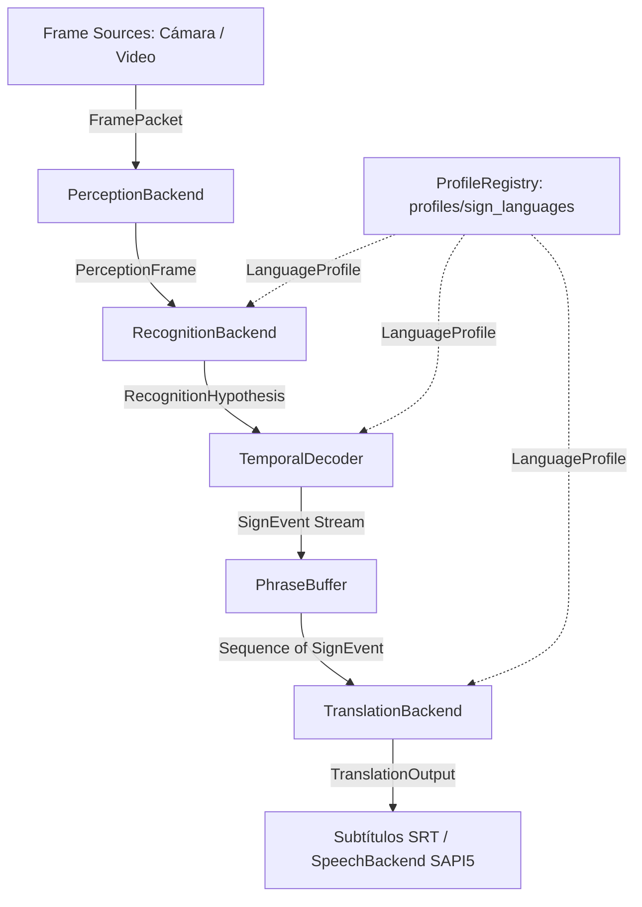
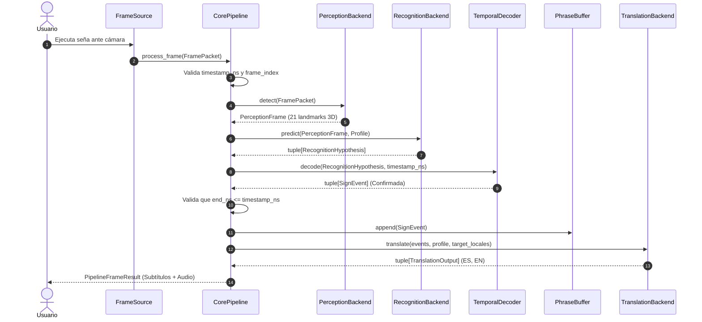

# SLT Architecture Master Specification

**Versión:** 1.0.0 (Fase 0 - Fundacional)  
**Alcance:** Arquitectura desacoplada, multilingüe, temporal y multiplataforma para SLT Bilingual Core.

---

## 1. System Overview

El sistema **SLT Bilingual Core** está estructurado como un espacio de trabajo modular para la percepción, reconocimiento continuo, estructuración semántica y traducción simultánea de lengua de señas a múltiples idiomas hablados y escritos.

### Diagrama General de Componentes

---

## 2. SLT Core (`src/slt_core/`)

El núcleo (`slt_core`) es una biblioteca pura de Python independiente de interfaces gráficas y de modelos pesados en tiempo de ejecución. Centraliza los contratos de datos inmutables, la gestión de perfiles lingüísticos, el buffer de frases y el orquestador principal del pipeline (`CorePipeline`).

---

## 3. Perception Interface (`PerceptionBackend`)

Define el protocolo que cualquier motor de visión (MediaPipe Tasks, OpenPose, o backends propios) debe satisfacer:
- Propiedad `ready: bool`
- Método `detect(packet: FramePacket) -> PerceptionFrame`
- Método `close() -> None`

Entrega `PerceptionFrame` con las 21 coordenadas 3D de cada mano, lateralidad (`LEFT`, `RIGHT`, `UNKNOWN`) y scores de detección.

---

## 4. Recognition Interface (`RecognitionBackend`)

Evalúa las observaciones anatómicas del fotograma actual frente al espacio geométrico o latente del perfil lingüístico activo:
- Propiedad `ready: bool`
- Método `predict(frame: PerceptionFrame, profile: LanguageProfile) -> tuple[RecognitionHypothesis, ...]`
- Método `close() -> None`

Emite tuplas de `RecognitionHypothesis` conteniendo candidatos de glosas y sus correspondientes valores de confianza y semántica (`CALIBRATED_PROBABILITY`, `UNCALIBRATED_SCORE`, `DISTANCE`).

---

## 5. Temporal Decoder (`TemporalDecoder`)

Componente independiente encargado de transformar hipótesis cuadro a cuadro en eventos discretos y estables de señas:
- Segmenta el inicio (`start_ns`) y fin (`end_ns`) de cada seña.
- Filtra movimientos de transición (epéntesis gestual) mediante quórum temporal e histéresis.
- Emite instancias de `SignEvent`.

---

## 6. Language Profiles (`LanguageProfile` & `ProfileRegistry`)

Gestiona la soberanía lingüística de cada lengua de señas:
- Registro estricto mediante `manifest.json`.
- Validación de identificadores alfanuméricos seguros contra path traversal.
- Verificación de presencia de artefactos (`artifacts_present`).
- Declaración explícita de capacidades cinemáticas (`static_signs`, `dynamic_signs`, `two_hand_signs`, etc.).
- Asociación con locales de salida válidos (ej. `es-CO`, `en-US`).

---

## 7. Translation Interface (`TranslationBackend`)

Transforma la secuencia cronológica de señas en oraciones coherentes y naturales:
- Recibe las señas de `PhraseBuffer`, el perfil activo y los locales solicitados.
- Realiza el mapeo semántico intermedio y genera realizaciones gramaticales para cada idioma de salida.
- Emite tuplas de `TranslationOutput`.

---

## 8. Phrase Buffer (`PhraseBuffer`)

Mantiene la memoria a corto plazo del enunciado en curso:
- Almacena secuencias de `SignEvent` asegurando orden temporal monótono.
- Previene la inserción de eventos duplicados mediante control por `event_id`.
- Impide la mezcla de eventos pertenecientes a diferentes lenguas de señas.
- Proporciona operaciones de corrección (`undo`) y limpieza (`clear`).

---

## 9. Frame Sources (`FrameSource`)

Abstracción que unifica cualquier origen de fotogramas:
- `CameraSource`: Cámara web en vivo (reloj monótono del sistema).
- `VideoFileSource`: Archivo de video local (Presentation Timestamps $PTS \times time\_base$).
- Ambas fuentes producen el mismo contrato estándar: `FramePacket`.

---

## 10. Timestamp Management

- Cada fuente mantiene su propio dominio temporal independiente expresado en nanosegundos enteros (`int`).
- Se imponen comprobaciones estrictas en `CorePipeline`: tanto el índice de fotograma (`frame_index`) como el timestamp (`timestamp_ns`) deben ser estrictamente crecientes por cada `source_id`.

---

## 11. Cross-platform Abstraction

Aislamiento de particularidades de sistema operativo en `src/slt/platform/`:
- Detección de capacidades de aceleración de hardware.
- Selección automática de backends de cámara (DirectShow/MSMF en Windows, V4L2 en Linux, AVFoundation en macOS).
- Selección de síntesis de voz (SAPI5 en Windows, `say`/NSSpeechSynthesizer en macOS, `espeak-ng` en Linux).

---

## 12. Error Handling (`src/slt_core/errors.py`)

Jerarquía estructurada de excepciones:
- `SLTError`: Excepción raíz de la plataforma.
- `ValidationError`: Violaciones en contratos de datos o parámetros.
- `ProfileError` / `ProfileManifestError`: Problemas en perfiles lingüísticos o manifiestos.
- `ComponentNotReadyError`: Intentos de procesamiento con componentes no inicializados.
- `ComponentContractError`: Respuestas de componentes que violan contratos.
- `TimestampOrderError` / `EventOrderError`: Deriva o regresión temporal en fotogramas o eventos.

---

## 13. Resource Lifecycle

Todos los motores (`PerceptionBackend`, `RecognitionBackend`, `TemporalDecoder`, `TranslationBackend`, `FrameSource`, `SpeechBackend`) implementan un método explícito `close()`. El `CorePipeline.close()` garantiza la liberación secuencial y segura de recursos sin fugas de memoria ni hilos huérfanos.

---

## 14. Extension Points

El diseño permite incorporar con cero modificaciones al núcleo:
1. Nuevas lenguas de señas agregando carpetas en `profiles/sign_languages/`.
2. Nuevos idiomas de salida añadiendo realizadores en el backend de traducción.
3. Nuevos modelos de visión artificial (MediaPipe, YOLO-Hands, modelos ONNX).
4. Nuevos decodificadores temporales (HMMs, redes recurrentes, Transformers temporales).

---

## 15. Recorrido de un Evento (Sequence Diagram)

