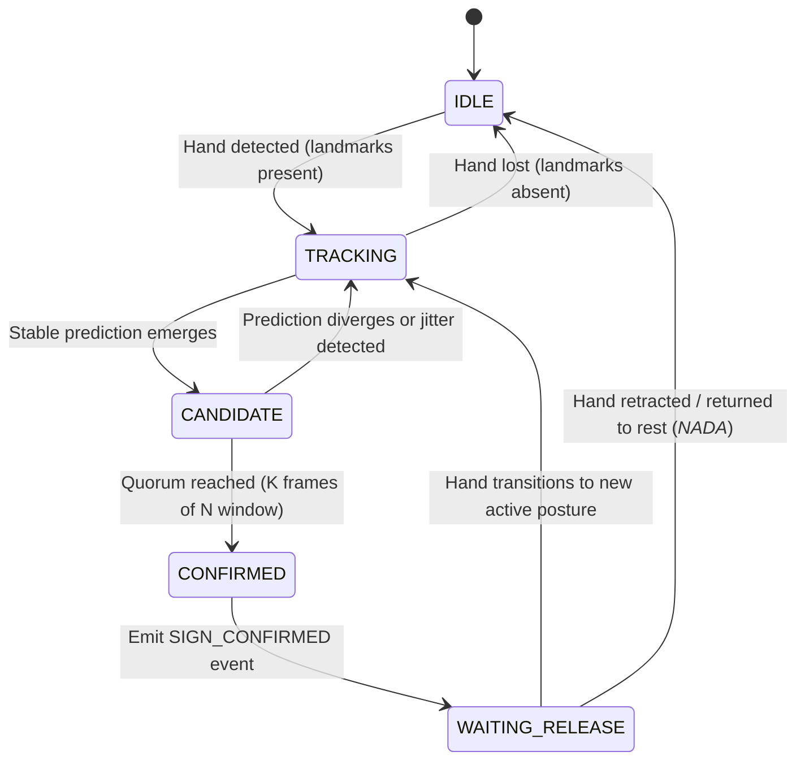

# SLT Interaction Specification

> **Scientific Inspiration**: AutoNav Human-Machine Interface ([Scientific Reports 2024](https://www.nature.com/articles/s41598-024-80898-x), CC BY 4.0). Adapted by SLT for linguistic interaction.

## 1. Philosophical Grounding

In sign language communication, a frame containing a hand gesture is not an independent command. Humans do not communicate via flickering static snapshots; communication progresses through preparation, stroke, retention, and retraction.

Treating every frame as an independent classification triggers accidental activations, duplicates letters, and creates visual chaos. The **SLT Interaction Engine** implements a temporal discrete state machine that tracks sign evolution over time and only emits confirmed linguistic events.

---

## 2. Finite State Machine: `InteractionState`



### State Definitions

| State | Condition | System Action |
| :--- | :--- | :--- |
| `IDLE` | No hand detected in frame | Wait, reset candidate accumulator. |
| `TRACKING` | 1 or 2 hands detected, but no clear sign candidate yet | Track hand landmarks, evaluate candidate predictions. |
| `CANDIDATE` | A valid sign prediction matches consecutive frames | Accumulate evidence in sliding window (quorum check). |
| `CONFIRMED` | Candidate surpasses stability and duration thresholds | Construct immutable `SignEvent`, append to Timeline, dispatch to Language Engine. |
| `WAITING_RELEASE` | Sign has been confirmed and registered | Freeze further registrations of the same gloss until sign is released or posture changes. |

---

## 3. Data Contract: `SignEvent`

```python
from dataclasses import dataclass
import time

@dataclass(frozen=True)
class SignEvent:
    """Immutable representation of a confirmed sign event in the interaction timeline."""
    event_id: str
    label: str
    timestamp_start: float
    timestamp_end: float
    stability: float
    handedness: str
    event_type: str = "SIGN_CONFIRMED"

    @property
    def duration_seconds(self) -> float:
        return max(0.0, self.timestamp_end - self.timestamp_start)
```

---

## 4. Quorum & Debounce Parameters

- **Sliding Window Size ($W$)**: 7 consecutive video frames (~230 ms at 30 FPS).
- **Quorum Threshold ($Q$)**: Minimum 5 matching frames ($5/7 \approx 71.4\%$) within the window.
- **Minimum Hold Duration ($\tau_{hold}$)**: 200 ms to confirm intentional execution.
- **Release Threshold ($\tau_{release}$)**: Minimum 3 consecutive frames of neutral rest (`_NADA_`) or alternative posture to clear `WAITING_RELEASE`.
- **Duplicate Suppression**: Prevents re-emitting the same gloss if the user holds the posture steadily.
